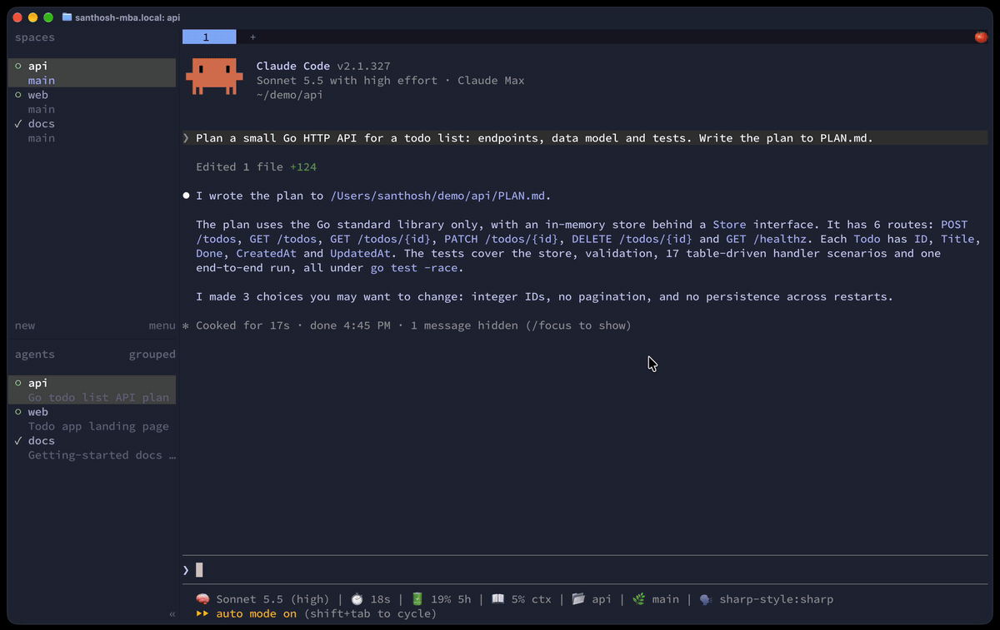
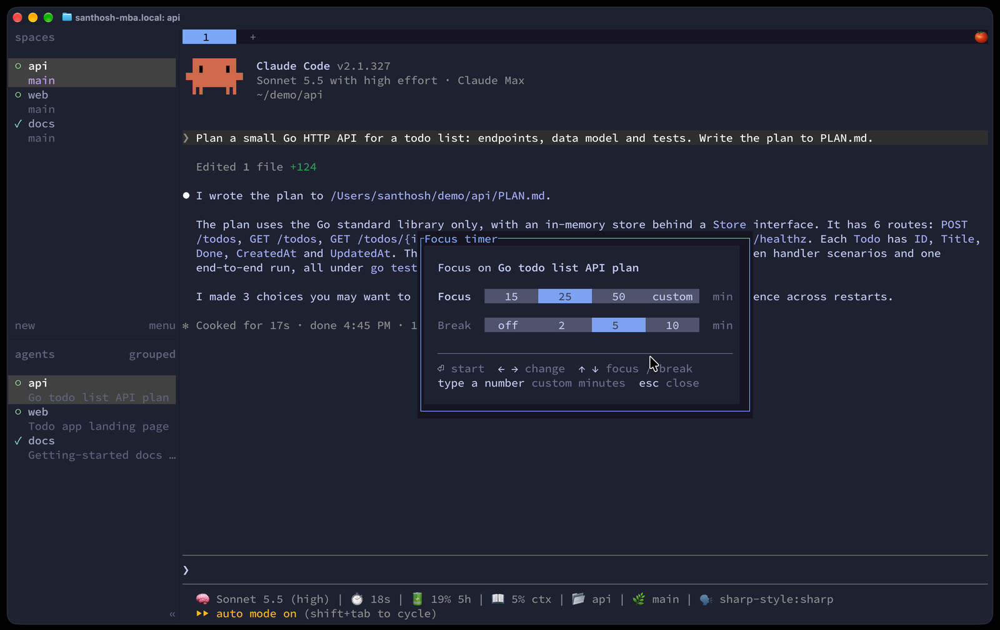
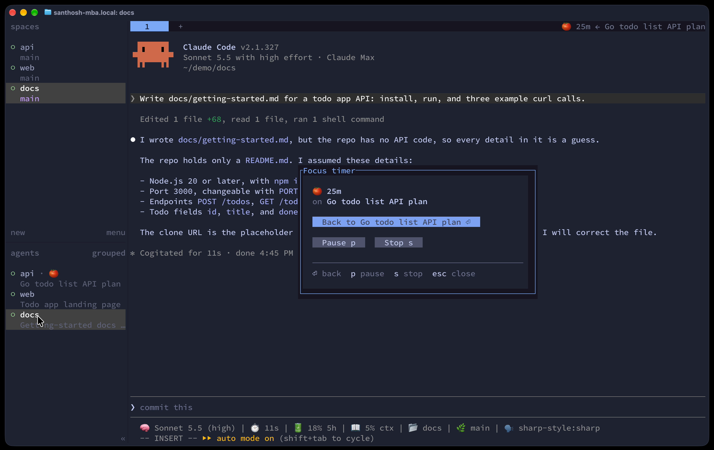

# herdr-focus

A focus timer for [herdr](https://herdr.dev). Pick the agent you are working
with, start a focus, and herdr's tab bar shows the time left. Wander off to
another agent and the tab bar points you back.



- **Start a focus** from a popup: 15, 25 or 50 minutes, or your own, with a
  break after it.
- **Stay on one agent.** The tab bar shows `🍅 18m`. Switch away and it shows
  `🍅 18m ← herdr-focus`; one key takes you back.
- **Take the break.** When the focus ends, the break starts on its own.
- **Nothing is locked.** It only nudges.

| Start a focus | Away from your agent |
|---|---|
|  |  |

## Install

Paste this into your coding agent:

```
Set me up with herdr-focus: read https://raw.githubusercontent.com/santhoshsram/herdr-focus/main/SETUP.md and follow it.
```

It installs the plugin and adds the config to your herdr config, keeping
what you already have.

Needs herdr 0.9.5 or newer, on macOS (Apple silicon) or Linux (x86_64 or
arm64). You do not need Rust.

<details>
<summary>Install by hand</summary>

```
herdr plugin install santhoshsram/herdr-focus
```

Add this to `~/.config/herdr/config.toml`:

```toml
[[keys.command]]
key = "prefix+f"
type = "plugin_action"
command = "focus.open"
description = "focus timer"

[ui]
tab_bar_right = [
  { type = "command", command = "~/.local/state/herdr/plugins/focus/herdr-focus status", interval_seconds = 1, timeout_seconds = 1 },
]

# "$focus" puts the 🍅 on the sidebar row of the agent you focus on.
[ui.sidebar.agents]
rows = [["state_icon", "machine", "workspace", "tab", "$focus"], ["agent"]]
```

If your config already has any of these tables, add the lines to the ones
you have instead of pasting a second copy: the timer goes last in
`tab_bar_right`, and `"$focus"` goes last in the first row of each sidebar
layout. Then run `herdr config check` and `herdr server reload-config`.

</details>

## Use

Press your herdr prefix, then `f` (for example `ctrl+space`, then `f`).

- **No timer running:** pick a focus and a break length, then Enter. Enter
  repeats your last choice.
- **Timer running:** pause, resume, stop, or go back to your agent.

Arrow keys and the mouse both work.

## Uninstall

```
herdr plugin uninstall focus
rm -rf ~/.local/state/herdr/plugins/focus
```

Then remove the `focus.open` key, the `herdr-focus status` tab bar entry and
`"$focus"` from your `config.toml`.
